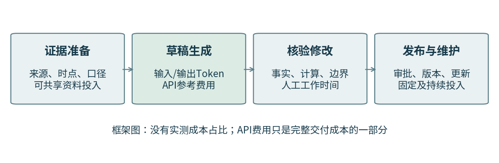
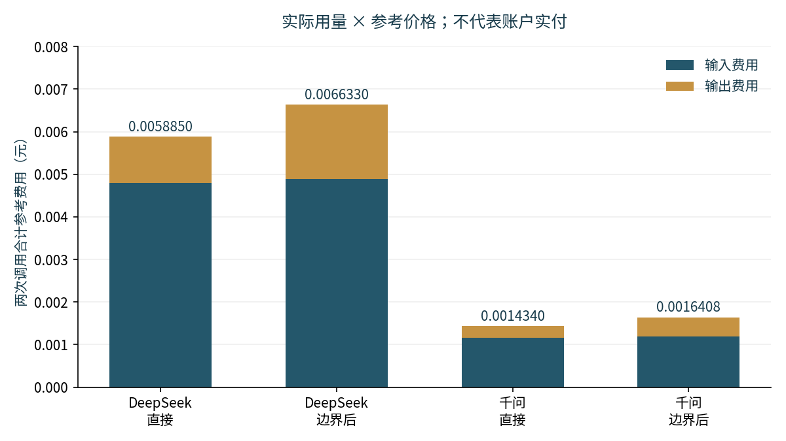
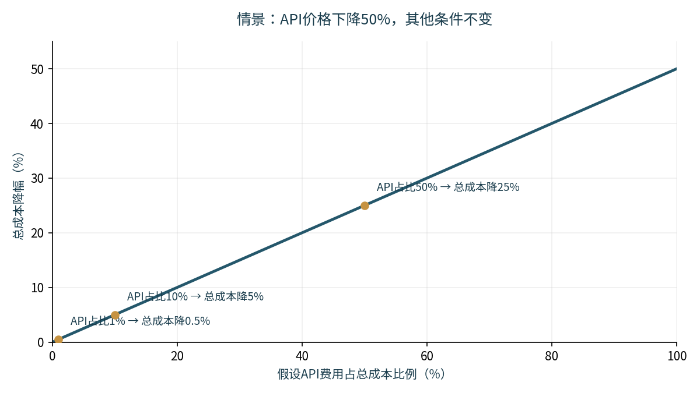
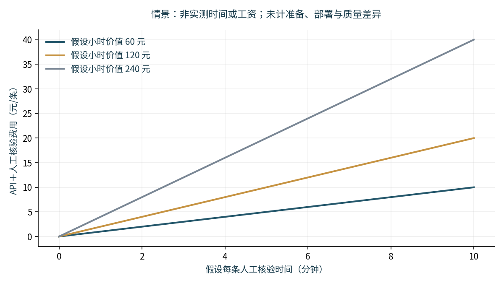

# 一条合格回复值多少Token？
## 生成式AI辅助上市公司投资者问答的成本、质量与边界

天津大学分赛场｜2026年10月29日数据截点｜探索性预实验报告主稿

## 摘要

生成式人工智能降低了文本生成的计费门槛，但有效回复并不等于流畅文字。本文以真实投资者提问为单位，考察公开证据、回答边界和核验劳动如何影响质量与成本。研究整理四家公司20道候选问题，其中9道有可定位的提问时间；选取苏泊尔两题，使用DeepSeek与千问分别完成直接生成和边界判断后生成，取得8份实际输出。“合格”指满足研究评价标准，不等于完整法律合规。

8次调用共消耗21,420个输入Token、1,618个输出Token，API参考费用为0.0155928元，实付尚待账单核实。输出核查发现：正确数字可能附带无依据解释，谨慎措辞也可能遗漏可计算内容。A首次与D回传版的合格判断一致3/8；A校准后与D均判3条通过，但细项口径仍有分歧。按当前门槛，本批每条合格草稿API参考费用为0.0051976元，不含资料、人工和部署，不作模型总体能力或企业交付成本估计。

若用量、质量、人工时间和其他投入不变，API单价下降50%带来的总成本降幅，仅为API费用占比的一半。研究据此说明，可信回复需要可追溯证据、有限承诺和可复核加工，经济收益不能只由Token单价推断。本文未完成企业现场实验，未测得人工节省或信息公平改善。

关键词：Token经济；投资者关系；生成式人工智能；质量调整成本；证据核验

# 一、从一条回复出发：低价生成为什么不等于低成本交付

## 1.1 投资者买单的不是字数，而是能够使用的解释

投资者在互动平台上提出的问题常常只有几句话：研发比例为什么低于同行，销量增长为什么没有带来同等幅度的收入增长，公司对某项业务有什么规划。问题的语言很日常，回答所需的工作却并不简单。回答者要确定期间和单位，定位相关公告，区分公司自身数据与投资者的假设，并判断材料是否支持“为什么”这一因果追问。最终呈现的一段文字，只是这些工作的外部结果。

生成式AI能够迅速把材料组织成通顺的回复，但通顺、准确和可交付是不同属性。一个模型可以准确复述收入增幅，同时给出并无依据的经营原因；也可以礼貌地表示“资料不足”，却没有计算材料已经允许计算的指标。前者制造了虚假的确定性，后者浪费了现成的信息。对上市公司而言，这两种情形都可能增加人工核验或重写工作；对投资者而言，它们分别影响信息可信度和信息获得的充分性。

因此，本文把研究单位缩小到“一道真实提问及其回复生产过程”。问题不是AI能生成多少字，而是：在事实、依据和回答边界都受到约束时，一条达到研究标准的回复需要哪些投入，Token价格下降又能降低其中哪一部分成本。这一小切口对应的是可信信息的生产、人机任务分配，以及普通投资者理解公开披露的机会。

## 1.2 一个真实案例揭示回复的责任边界

浙江证监局〔2024〕4号行政处罚决定记载，思美传媒在2023年11月27日的互动易回复中，对其与抖音超市的业务关系作出了与实际情况不符的表述。监管认定其构成误导性陈述，给予公司警告并罚款150万元，对相关责任人警告并罚款100万元。[1] 这说明公开互动中的业务范围和措辞并非无关紧要的修辞问题。

该决定没有把事件认定为AI事故，本文也不以它证明AI造成了错误。案例所提供的研究动机是：企业交付公开回复时，需要对内容负责。本文同样不把罚款直接除以回复数量，或把它当作每次模型错误的预期损失。要计算预期损失还需要错误发生概率、传播范围和实际处置结果，现有材料不能支持这些估计。

《上市公司投资者关系管理工作指引》既要求平等对待投资者、主动回应诉求，也要求披露真实准确完整，并限制未公开重大信息、误导性信息以及证券价格预测或承诺等行为。[2，第2、5、8页] 因而，好的回复不能只追求“尽量不说错”，还应在公开依据允许的范围内提供有用解释。本文使用“合格”一词，特指满足本研究评价标准，不以公开资料实验替代完整法律合规审查。

## 1.3 三个问题与证据层级

本文提出三个相互衔接的问题。第一，单次生成费用较低，是否意味着每条合格草稿也更便宜？第二，要求模型先识别可答范围与资料缺口，会怎样改变输出及费用，能否避免编造原因而又不遗漏可答内容？第三，加入证据准备和人工加工后，Token降价对最终成本还剩多大影响？

本文对这三个问题提供的证据强度并不相同。对实际调用的Token和参考费用，可以逐条复算；对具体回复的缺陷，可以回到原页讨论；对模型总体能力和人工效率，现有两题不能给出可靠估计。对价格下降的影响，本文采用明确固定条件的代数分析和情景计算，而不将假设参数伪装为企业实际经营数据。

这一安排使报告同时保留现实问题和可验证范围。小样本不足以支撑宏大因果结论，却可以检验数据链条是否成立，暴露评价尺度的歧义，并说明后续正式研究应当测量什么。未完成的实验规模不计入本文的实证成果。

# 二、文献与分析框架：互动价值来自内容，不只来自供给量

## 2.1 平台互动、信息不对称与意见分歧

Chen等的2025年8月工作稿研究投资者互动平台活动与信息不对称，回归样本包含4,680家公司和7,818,963个公司—交易日观测。研究区分提问与评论、回复质量及回复时效，高质量回复与更低报价价差的关联较强；在2018—2022年子样本中，及时和不及时的高质量回复之间的差异并不显著。[3，正文第9—10、18—21页及表6B] 这提示评价应关注回复内容及具体时期，不能简单以数量或速度代表价值。

该工作稿中的“直接回答”等文本分类标签，并不等于本文的事实核验结论。分类器识别某种表达特征的准确率，也不是生成式模型回答公司问题的正确率。本文借鉴的是区分内容质量的必要性，而不是直接搬用论文的标签作为合格标准。该稿尚属工作论文，早期版本与2025年修订版不能重复计作两项独立研究。

徐寿福、郑迎飞和罗雨杰使用92,155个公司—季度观测，研究平台互动与股票异质性风险的关系，并讨论投资者意见分歧机制。[4，第156—159、162页] 这一研究提示互动增加也可能伴随噪音和不同解释。它并不证明AI生成回复会造成股价风险，但提醒本文不能把“更多回复”直接等同于“更高社会福利”。

上述研究讨论的市场结果具有更大样本和更长时间跨度。本文聚焦回复生产环节，不在两题测试上复制市场层面的识别结论。信息不对称、意见分歧和投资者保护用于解释研究意义；其是否实际改善，需要另行收集投资者理解、信息获得和市场行为的数据。

## 2.2 用大模型测量互动，与让大模型生产回复

樊犇、吴燕博和刘恒源利用Word2vec与Qwen2.5-72B识别投资者互动监督，基于2011—2023年沪深A股25,996个公司—年度观测研究真实盈余管理。论文报告互动监督指标与真实盈余管理的负向关系，并分析信息透明度等机制。[5，第97—101页] 这项研究已经把大模型用于互动文本测量，因此本文不声称“首次将大模型用于投资者互动”。

两种研究任务的差异值得强调。用于测量的大模型把历史文本转化为解释变量，重点是测量误差及其对经济关系估计的影响；用于生产的大模型则向使用者交付新的文本，重点是新陈述是否有证据、遗漏了什么，以及需要多少人工加工才能使用。前一种任务的有效性不能自动证明后一种任务的可靠性。

表1汇总了相关研究对本文的用途与边界。本文的研究定位是将真实问题、历史证据、回复质量及加工成本连接起来。现有阅读支持这一组合的研究价值，但不是覆盖所有数据库的系统性综述，不能据此宣称不存在相似研究。

表1　文献与本研究的衔接

| 研究 | 样本与方法要点 | 对本文的启发 | 不能直接推出的结论 |
|---|---|---|---|
| Chen等，2025工作稿 | 4,680家公司；7,818,963公司—交易日；文本分类 | 区分数量、质量和时效 | 分类质量不等于生成回复事实正确率 |
| 徐寿福等，2022 | 92,155公司—季度；互动与异质性风险 | 信息供给可能伴随分歧 | 不能断言AI导致市场风险 |
| 樊犇等，2026 | 25,996公司—年度；LLM识别监督 | 大模型已经进入互动文本测量 | 监督关系不等于生成回复节省成本 |

注：页码及样本口径见参考文献[3]—[5]；工作论文与已发表论文分别标示。

## 2.3 把回复看作需要多环节加工的信息产品

本文将回复生产划分为四个环节：准备证据、生成草稿、核验修改、发布与维护。证据准备包括定位原问题、确定信息截止时点、下载公告和统一口径。生成环节包括输入材料、调用模型及失败处理。核验修改包括查证数字、判断依据是否支持结论、补齐遗漏和调整表述。发布维护则涉及审批、版本保存和后续更新。

四个环节的可复用程度不同。一份年报可以服务多道问题，但不同提问时点需要不同的信息集；一段通用提示词可以反复使用，但不能代替每条回复的事实责任。固定投入随业务量摊薄，逐条核验则可能持续发生。因此，不能把研究中一次整理年报的成本全部记在每条回复上，也不能因为年报已下载就把以后的检索和更新成本视为零。

从经济意义看，AI替代的是某些具体任务，而非自动替代整项职责。当模型减少撰写时间却增加核验时间时，净收益可能很小；如果输出能够把每个关键陈述准确对应到原页，则即使文字生成速度相同，也可能降低核验负担。后一个机制是本文提出的可检验方向，现有记录尚没有人工时间来验证。

图1　回复生产过程。API账单覆盖生成环节；其他环节需另行记录。图为研究框架，不是实测成本占比。

# 三、数据和方法：先控制证据，再评价回复

## 3.1 候选问题与实际执行范围

研究最初拟开展20题预实验、80题正式实验和24题人工对照子样本。截至本稿数据截点，实际已整理20道候选问题，涉及智动力、苏泊尔、老板电器和立讯精密四家公司；9题可定位原平台提问时间，11题只有说明会活动日期。原定8家公司、两个行业的正式样本尚未完成，不能把业务分组当作已核实的行业分类，也不能把20道候选题写成20道已完成实验题。

实际API测试选取苏泊尔P-A07与P-A08。前者询问研发投入比例与同行差异及长期竞争力；后者询问炊具销量增长快于收入增长的原因。这两题具有可核查的提问时间和原年报页，适合检验接口、计费和评分流程，但都是同一公司的解释型问题，不能代表不同公司或所有问题类型。两题各有四份输出，共8份，统计上的任务单位仍然只有两道。

表2　样本准备与实际执行数量

| 环节 | 已记录数量 | 解释 |
|---|---:|---|
| 候选问题 | 20题、4家公司 | 是收集池，不是完成实验数 |
| 原始提问时间可定位 | 9题 | 时间可定位不等于所有答案标准均已冻结 |
| 只有活动日期、仍需补证 | 11题 | 不能把活动日当原始提问日 |
| 本文实际调用 | 2题、8次 | 两模型×两流程；无收到的重试记录 |
| 受控人工写作记录 | 0次 | 不报告人工提效实测结论 |

候选池的来源包括互动易云访谈和公司公开的网上说明会记录。它们都属于投资者交流材料，却不完全等同于日常互动易原帖。采集时保留来源类型和原文位置；从PDF合并换行不改变语义，任何替换题另建编号，不覆盖原题。11道缺时间的题仍保留检索与排除状态，不因难以处理而无痕删除。

## 3.2 提问时点和证据包

两道实际问题的提问时间分别为2026年4月9日16:29:19和16:31:18，来源为苏泊尔2025年度网上业绩说明会页面。[7] 本文统一使用前一日末，即2026年4月8日23:59:59作为保守证据截止。核心证据为4月3日披露的苏泊尔2025年年度报告，早于该截止。[6] P-A07输入原第16页，P-A08输入原第12—14页。

每份证据记录文件名、披露日期、物理页码、文本摘录和SHA-256校验值。模型仅接收相应问题及冻结的原页文字，不接收参考答案、评分记录或事后公司回复。PDF原页用于核查文本提取，问题来源中的公司回复与模型输入分开保存。模型可能在预训练中接触过历史问题，这一风险不能因本次禁联网而被完全排除；评价仍只接受给定证据支持的陈述。

这里的“证据不足”限定于记录的信息集，并不等于公司从未披露相关信息。例如，对同行数据或经营原因，本题年报页没有提供，模型就不能用外部常识填空；若后续在提问前公告中发现相关内容，应在新实验前一致更新证据包，而不能只给某一条件补充材料。

一个未进入本轮测试的苏泊尔候选题，涉及原第12、13页两张表对食物料理电器收入的不同列示。差异已在原件中核实，原因尚未得到说明。这种问题应被保留为标准未决，而非任选一个数值作为唯一答案。实际P-A08的炊具数据在相关表中一致；若回复自行增加其他品类内容，则仍要核对其具体表格口径。

## 3.3 两模型、两流程及运行记录

实际服务调用使用deepseek-flash与qwen3.7-flash-2026-07-15。后者为阿里云百炼北京地域服务的快照模型；前者响应中返回的是别名，官方文档中的版本映射不能替代服务端不可变版本证明。[8][9] 调用采用temperature=0、max_tokens=2048、stream=false，并关闭两模型的内置思考模式，未配置联网或外部工具。温度为零不意味着跨时间、跨服务实现的输出必然一致。

两流程共享问题、证据、系统约束与最终回复篇幅要求。直接流程输出最终回复和引用；边界流程先给出可答项目、资料缺口与回答限制的简短清单，再输出最终回复。该清单是可审计的任务结果，不要求模型暴露内部思维过程。评价只读取最终回复与引用，额外清单仍计入输出Token和费用。

调用发生于2026年10月24日凌晨。收到的8份记录均返回HTTP 200、finish_reason为stop，解析成功，没有收到重试记录。研究逐条核对原始请求与输入包、响应与usage、匿名文本与解析结果；没有发现匿名导出修改答案或复制覆盖。技术完成不代表内容合格，也不证明账户实际扣费已由服务商账单确认。

## 3.4 四维评价与关键错误否决

评价采用F事实、E引用、C核心覆盖、B回答边界四个维度，每项0—2分。事实关注期间、单位、数值和重要断言的可核验性；引用关注材料是否实际支持所述结论，而不只看有没有页码；覆盖关注可答核心是否完整且正确；边界关注已知、推导和未知是否被区分。所有适用维度均达到2且不存在关键错误时，才满足合格门槛，维度间不以加总分抵消。

重要无依据结论可能同时影响事实核验、引用和边界，但解释时要避免把“现有证据不支持”说成“已证明现实中相反事实”。本稿对重要无依据因果的F归类采用校准判断，E和B的不足及关键错误否决不依赖这一归类。若独立评价者对同一缺陷应归入哪一维有不同理解，应保存分歧并澄清规则，不追溯抹去原始记录。

P-A07的核心包括自身研发数据、同行比较前提和竞争结果的证据边界。P-A08的核心包括同类别收入与销量比较、类别平均收入测算，以及该均值不能证明同款产品降价或唯一经营原因的限制。具体分组是校准工具，不能看某条回答表现后临时增加必答点。P-A08的均值测算已见于调用前答案要求，本次并非看到输出后新加计算任务。

“标准U”表示问题或证据标准本身未决，不表示模型答得不好；使用NA则须说明该维度为何确实不适用。无依据回答与过度拒答分别记录：漏掉要点不自动构成拒答，只有存在可答内容却以拒绝或空泛表述回避时，才需按约定判断过度拒答。本批CAL-05的过度拒答标签在A校准视图与D之间存在分歧，本文保留双方标记，不给出总体过度拒答率。

## 3.5 评价过程及其限制

A先独立填写8条评分，随后根据助手指出的字段冲突形成复核版，再明确授权助手对两条未决回复作辅助裁定。首次评分、复核版和辅助裁定分别留存。当前视图中6条沿用A复核版，CAL-04与CAL-07由助手辅助裁定；后者不是新增人类独立评分，也不属于完全盲评。

D于10月28日完成的两份评分文件已回收，8条结构化评分、合格标记与覆盖计数相同，匿名回复亦与原始输出相符。D声明评分前未看模型映射、A评分和参考答案；队长另行确认D也未看过CAL-04、CAL-07的具体改分讨论。该记录依据当事人声明与队长确认，不是对访问日志的审计。文件虽然标为独立版，但记录了D自己的覆盖分修订，未提供修订前的最早文件，因此本文称其为“D回传版”，不将其冒称为未修订的首次评分。

本稿分别比较A首次与D回传版、A校准后与D回传版，不把两个比较混合。前者用于定位评价尺度的问题；后者只能表示当前二元门槛判断是否一致。D同意了7项事实修订和5项规则确认，但新写的细则在覆盖分映射、引用支持范围等方面仍与A指南不同。两人的逐维共同裁定和正式规则冻结尚未完成；现有比较不是同一稳定手册下的正式信度验证。A复核前后也不是模型改善，因为输出没有改变。

原计划的纯人工与AI辅助任务未形成可分析的完成记录。本文因此不报告撰写节省比例、不把评分耗时当作回复生产时间，也不把API响应延迟当作投关人员的总工作时间。这些区分限制了结论范围，却保证了各项数字所指向的是实际发生的工作。

# 四、已完成的观察：生成便宜，核验并未消失

## 4.1 8次调用的Token与参考费用

表3列出四个条件的真实用量及按参考单价复算的费用。全部调用合计输入21,420 Token、输出1,618 Token，共23,038 Token。缓存命中记录为0；未单独返回的推理Token字段保留缺失，不将其虚构为额外零值证据，也不重复计入总量。DeepSeek对应空闲时段输入未命中1元/百万Token、输出4元/百万Token；千问对应北京快照模型、输入不超过32k档的0.2元和0.8元。[8][9]

表3　两题四条件的实际用量与参考费用

| 模型与流程 | 调用数 | 输入Token | 输出Token | 参考费用合计/元 |
|---|---:|---:|---:|---:|
| DeepSeek直接生成 | 2 | 4,793 | 273 | 0.0058850 |
| DeepSeek边界后生成 | 2 | 4,889 | 436 | 0.0066330 |
| 千问直接生成 | 2 | 5,822 | 337 | 0.0014340 |
| 千问边界后生成 | 2 | 5,916 | 572 | 0.0016408 |
| 合计 | 8 | 21,420 | 1,618 | 0.0155928 |

注：用量来自C交回的原始响应；费用由研究者按记录的参考价复算，不是账户实付证明。价格在10月24日核查，并于10月28日复核对应官方说明；历史实际扣费仍以账单为准。原始计费包括结构化输出和边界清单，并非只计最终回复字数。

8次生成的平均参考费用为0.0019491元/次。边界流程在这两题中使DeepSeek费用增加约12.71%，使千问增加约14.42%，主要伴随输出Token增加。这一观察只描述本次固定输入和服务参数下的账面变化，不能推断边界流程在所有题目上具有相同增幅，也不能据此判断增加的费用是否值得。

跨模型的Token数也不宜直接解释为相同文字的“思考量”。不同服务可能使用不同的分词与消息计数规则，Token是各自服务中的计费单位；本次比较的是记录用量与对应价格的乘积。类似地，单次延迟受网络、服务负载和执行顺序影响，本研究不以两次平均延迟代表长期服务速度。

图2　每个条件两次调用的参考费用，单位为元。输入、输出分别按服务计费口径计算；图中不包含人工、资料或部署成本。

## 4.2 数字正确，为什么仍可能答错

研发问题的一条回复准确给出了2.09%的研发占比和零资本化率，却进一步声称公司与同行的差异源于商业模式，并确定表示长期竞争力未受损。原年报第16页提供了公司研发金额、人员及研发方向，没有提供足以验证这些比较和因果的材料。资本化率为零，也不能单独证明整体财务稳健。[6，第16页]

这类错误的困难在于，错误未必出现在最容易检查的数字上。真实数字和有效页码可以让整个段落显得可靠，而没有依据的结论附着在正确事实之后。若审核者只核对数字、看到引用就停止，便可能遗漏真正影响投资者理解的部分。因而，“附了来源”只是审查入口，不能替代陈述与证据的对应关系。

销量问题的另一条回复引用了收入增速1.89%、成本增速2.17%及毛利率变化，却以成本增速较高解释收入增长偏慢。成本与收入的关系可以用于解释毛利率，不能仅凭这些数据说明为什么销量增长没有转化为相同幅度的收入增长。该错误发生在变量之间的解释关系上，而不是简单抄错一个百分比。[6，第13—14页]

这两个例子分别对应“用确定语气填补证据缺口”和“把一个关系移用到另一问题”。A助手辅助校准与D回传版均将这两条标为关键错误、判为不合格，虽然对F、E及边界严重程度的分数并不完全相同。这说明核验对象应包括因果、范围和承诺。它们是对实际输出的案例分析，不是两种错误在全部投资者回复中发生频率的估计。

## 4.3 资料不足的说法，也需要接受核验

P-A08涉及炊具同一类别的收入和销售量。根据原年报，2025年收入为6,965,677,978.67元、销量为92,664,612台/套；2024年分别为6,836,158,028.21元和85,724,597台/套。将同类别收入除以销量，可得2025年每台/套平均收入约75.17元，2024年约79.75元；按未舍入值计算，下降约5.74%。[6，第13—14页]

平均收入下降不等于同款商品降价。产品结构、销售组合以及收入与销量的统计口径都会影响这一比值。一个边界清晰的回答应同时说明“能算出什么”和“不能由此推出什么”：前者是类别平均收入的变化，后者是同款价格变化、具体经营原因及其唯一贡献。把两者合并为“年报未披露，所以无法分析”，会遗漏可用信息。

本次四份P-A08输出均未完成该项数值测算，虽然部分已经提醒存在价格或口径限制。这一事实支持将计算覆盖与边界谨慎分开评分，但不意味着每个漏项都应直接认定过度拒答。具体拒答标记还需看措辞是否以资料不足回避可以完成的部分，并由评价者按相同标准处理。

对投资者来说，可靠解释通常是有层次的：先给同口径事实，再给可复算推导，最后说明未知。它既不需要模型冒充管理层掌握全部经营原因，也不应把可以核验的计算让渡给一句泛化提醒。这种组织方式是本文提出的回复生产要求，不是公司正式答复。

## 4.4 评分版本揭示的核验劳动

A首次的四维分数均为2，按门槛读取8条全部通过，但事实断言标记与覆盖记录存在冲突；之后的复核和助手辅助校准保留了更改原因。D回传版判定3条通过、5条未通过。因此，A首次与D回传版的合格判断仅在3条上相同，一致率为37.5%。这个数字不能被后续校准后的一致替换。

表4　同一批输出的评价版本与结果

| 评价版本 | 通过数/输出数 | 如何解释 |
|---|---:|---|
| A首次原件 | 8/8 | 含字段冲突，原件保留，不覆盖 |
| A复核版 | 3/8 | 已参考助手反馈，非新增独立评分 |
| A复核及两条助手辅助校准 | 3/8 | 通过CAL-01、03、06；两条另留裁定理由 |
| D回传自述独立版 | 3/8 | 同样通过CAL-01、03、06；文件含D内部修订 |

注：同一批模型输出未变化。表内四行不是四名独立评价者，也不表示模型在重复训练后改善。两题各有四份输出，不能当作八个独立问题。

按A首次和D回传版计算，观察一致率与机会一致率同为0.375，描述性Cohen κ为0。A首次全部属于同一类别，两方细则又不完全相同，因此这个值仅用于校准诊断，不作通用可靠性结论，也不计算显著性或置信区间。逐维分数相同数为F 8/8、E 8/8、C 3/8、B 6/8；这些分数的一致与最终合格判断的一致是不同指标。

A校准后与D的二元判断8/8一致，当前共同通过名单是CAL-01、03、06。它不能写成“首次独立双评100%一致”。细项差异仍需保留：D把覆盖1/3映射为0分，A指南把完成部分核心记为1分；D偏重数字是否有引用，而A辅助校准同时检查重要解释是否有依据；CAL-05是否构成过度拒答也不同。按两种现有标记，本批过度拒答数为0或1，即0%或12.5%，只是标注口径敏感性，不是置信区间或总体发生率。共同的通过名单没有消除这些定义问题。

本稿仅将3条通过用于本批草稿的回顾性API成本复算，不把它当作模型总体正确率或企业交付成功率，也不按模型、流程作质量排名。评分从“看起来合理”变为“逐项有据”，本身需要定义和核验劳动；这一劳动不能因API费用低而省略。

这也解释了为什么相近的回复不能简单去重。两道题各四个条件是预设的对照结构；同题共享数字是预期现象，关键差别可能只在一个因果词或确定性结论。八份文本均不同，并与原始响应一致；删掉看起来相似的回复会破坏条件对照。应保留全部输出及其评分版本。

# 五、从Token费用到合格产出成本

## 5.1 先把产出定义清楚

本文区分“合格草稿”和“完成交付的回复”。合格草稿通过研究评价门槛，但未必经过企业正式审批；完成交付还可能需要核验修改、授权发布和维护。两者的分母不同，不能把API生成的草稿数量直接当作企业已经交付的有效服务数量。

设一批任务的API费用为A，共有N次计划产出，合格草稿数为G，则草稿环节单位API成本为A/G，前提是G大于零。分子保留失败、无效输出及按预定流程发生的重试费用，不能只统计最后成功一次的价格。G为零时该指标未定义，不能写成零元；若有标准未决的U条，则应报告G/N至(G+U)/N的合格比例范围，并保留所有任务费用。

本批8次调用的参考费用合计0.0155928元，A校准后与D共同判为通过的草稿为3条，故回顾性单位草稿API参考成本为0.0155928÷3=0.0051976元。分子包含5条未通过输出的费用。它约为每次生成平均参考费用0.0019491元的2.67倍，但仍未纳入证据准备、评分、核验修改和部署成本。这个计算汇总了两题四条件的实际批次，仅说明分母改变后的费用口径，不是未来任务的期望成本，也不是企业已完成交付的成本。

对最终交付，令S为可归属的证据准备投入，H为人工阅读、核验和修改投入，F为本批分摊的部署维护投入，D为最终合格交付数，则单位交付成本为(A+S+H+F)/D。研究专用的双人评分和争议会议应另列，不全部伪装成公司日常业务成本；其中可迁移为日常质检的部分可以在另一情景中讨论。

这些公式不是把所有成本都强行货币化。缺少实际工资时可以分别报告分钟和API费用，再给出不同小时价值的情景。缺少真实错误损失概率时，罚款、股价变化和声誉损失不进入主公式。无法测量的项目可以解释其重要性，但不能补一个任意概率制造看似完整的总成本。

## 5.2 便宜模型何时不再便宜：一个采用条件

设两种生产方式每次尝试的全流程成本为c₁和c₂，合格概率为q₁和q₂。在相同任务组合、稳定质量、失败费用被完整计入等条件下，其质量调整单位成本分别近似为c₁/q₁与c₂/q₂。方式1更便宜的条件为c₁/c₂小于q₁/q₂。该关系表明，名义费用优势需要足够的合格率才能兑现；它并不预设高价模型质量更高。

若比较纯人工与AI辅助，应进一步考虑任务时间。假设两种方式最终质量相同，纯人工耗时tH，AI辅助的人类投入为tA，每条额外API费用a，新增资料与固定摊销为k，人工小时价值为w，则AI辅助具有成本优势的条件是w×(tH−tA)/60大于a+k。t的单位为分钟；tA应包含核验和修改，不能只计撰写动作。

如果最终质量不同，就必须回到各自合格交付数或合格概率比较，不能仅凭时间快宣布节省成本。本研究尚无受控人工时间，因而只提出上述可检验条件。真正的企业采用决策还应考虑系统接入、业务峰谷和审批要求，学生任务中的执行时间不能直接替代企业员工的工作表现。

## 5.3 Token价格下降50%，总成本能降多少

令本批总成本C=A+S+H+F，并假设所有纳入A的API价格同比下降50%，而Token用量、缓存结构、输出质量、人工时间、业务量及其他投入保持不变。降价后C′=0.5A+S+H+F，因此总成本降幅为(C−C′)/C=0.5A/C。若合格交付数量也不变，单位合格交付成本具有同样降幅。

例如API占总成本的1%、10%、50%时，50%的API降价分别使总成本下降0.5%、5%、25%。这些百分比是恒等式的情景代入，不是本文测得的成本结构。如果仅输出Token降价而输入价格不变，则应只对输出费用折扣；如果模型换代同时改变质量或核验时间，也不能继续直接使用这一静态比例。

图3　质量、用量、人工和交付数不变时的情景关系。横轴为假设的API成本占比，纵轴为总成本降幅；不含企业实测占比。

这一结果将Token经济中的两种变化区分开。价格下降降低每单位投入的购买成本；流程改善则可能减少输入量、核验时间或返工，提高合格交付数。前者主要改变成本分子的一个分项，后者可能同时改变分子和分母。两种改善可以并存，但只有分别测量，才知道收益来自哪里。

## 5.4 用透明假设展示核验时间的经济量级

为展示单位换算，取本次8次调用平均参考费用a=0.0019491元作为计费锚点，并假设每条额外人工核验耗时为1分钟，小时价值分别为60、120、240元。对应人工费用为1、2、4元，加上a后总额分别为1.0019491、2.0019491、4.0019491元。此表没有证据准备、部署摊销和质量差异，不能称为完整交付成本。

表5　人工核验情景：不是实测时间或工资

| 假设小时价值/元 | 假设核验时间/分钟 | 人工费用/元 | 加平均API费/元 | API降50%后总额降幅 |
|---|---:|---:|---:|---:|
| 60 | 1 | 1.00 | 1.0019491 | 约0.0973% |
| 120 | 1 | 2.00 | 2.0019491 | 约0.0487% |
| 240 | 1 | 4.00 | 4.0019491 | 约0.0244% |

表5说明的是一个量级条件：只要真实人工时间和小时价值接近这些设定，核验这一项就可能远大于当前测试中的API费。它不证明实际核验恰好需要1分钟，更不证明所有投关场景API费用都可忽略。长证据、多轮检索、重复调用和其他服务定价可能改变费用结构，正式研究仍须逐项记录。

在同样的平均API费下，一次50%的降价每条节省约0.00097455元；若小时价值为120元，这相当于约0.0292秒的人类时间价值。这个换算仅帮助理解本次计费锚点的量级，不能当作可测的操作时间节省。相反，若优化引用定位能减少可观的核验劳动，其价值可能更大；是否能做到，需要后续人工任务验证。

图4　以本次平均API费为锚点，改变假设人工时间及小时价值；未计准备、部署和质量差异。各曲线均为情景计算。

## 5.5 固定成本、规模与低价带来的新需求

资料整理和部署具有固定投入成分。若一套证据索引与流程的固定成本为K，在Q条可比任务之间分摊，每条为K/Q。业务量上升可以降低摊销，但不能保证边际核验时间不变：公告更新、复杂问题增加和审批拥堵都可能改变这一关系。共享年报的成本应在实际使用的任务中一次分配，不能对每个模型条件重复收取同一笔准备费用。

价格下降还可能刺激更多问题、更长回复或更多候选稿。这时总Token用量增加，静态降价公式不再完整描述总支出。本文没有估计需求弹性，因此不宣称已经观察到反弹效应。其可检验含义是：未来应同时观察价格、调用量、人工处理量和合格交付数，避免只看到单价下降而忽略总工作量变化。

对资源有限的企业，更合理的采用路径可能是先整理高频、证据明确的问题，再评估边际收益。对需要管理层确认、复杂跨表口径或面向未来承诺的问题，人工核验的责任并不会因为生成更便宜而消失。问题分流的依据应是可核验性和任务风险，而不是某个模型在少数题上的印象分。

# 六、社会含义与可执行的改进方向

## 6.1 从信息公开到信息可理解

公开公告提供了信息获取的基础，但理解公告仍需要定位、比较和计算能力。P-A08展示了这种差距：收入与销量都已披露，投资者还需要将它们按同一类别连接，才能理解增长率差异。AI若能准确完成这种解释，可以降低阅读门槛；若补上没有证据的原因，则可能把解释便利转化为误导。

因此，面向中小投资者的价值不应仅用回复速度衡量。后续可以测量投资者能否正确指出关键数据来源、区分类别均值与同款价格、理解哪些问题尚无依据，以及是否因确定语气形成不恰当信心。这些比笼统声称“改善信息公平”更接近可检验结果。本文未收集这些结果，不把社会意义写成已经验证的社会效果。

公平还涉及不同投资者面对同一问题是否获得一致且可追溯的解释。一个能够注明材料时间和出处的公开回复，有助于后来者检查依据；但如果公司只对部分人提供额外细节，模型表达再清晰也不能弥补披露过程的问题。技术工具应服务于一致的信息基础，而不是制造看似公开、实则无法追溯的答案。

## 6.2 对上市公司：以证据驱动的起草与审校

可执行的改进是把每个关键陈述对应到公开证据，再形成对外回复。对于提取型信息，核对数字、期间和单位；对于计算型信息，保留公式与原始数；对于解释型信息，区分公告明确说明、研究者推导和无法确认的原因。模型可以协助整理这些内容，发布责任仍需由公司现有流程承担。

审核清单宜短而有针对性：提问里的前提是否已经核实，引用是否支持完整句子，是否把可能写成必然，能回答的部分是否真正完成。对本次出现的错误，仅查错别字和数字不足以发现问题。具体审核流程能否减少时间，应在企业任务中验证，而不能仅因清单看起来合理就认定有效。

另一个改进是记录失败和返工。若只保存最后一版漂亮回复，管理者无法判断低价模型是否造成大量重写，也无法比较某种提示流程增加的Token是否换来了更少核验劳动。版本留痕既服务质量控制，也服务成本核算；其投入需要与业务规模匹配。

## 6.3 对模型服务和平台：让依据更容易核查

模型服务可以关注原页定位、数值计算和证据缺口表达，而不仅是更长、更自然的文字。对于费用透明度，应把输入、输出、缓存和失败调用的记录提供给使用者，便于将计费与具体任务关联。对可变模型别名，还应明确版本更新可能影响可复现性。这些建议基于研究中的记录需要，并非对某服务未履行义务的判断。

互动平台可以通过稳定的问题标识、明确区分提问时间与回复时间、保留修改记录来降低研究者和普通用户的追溯成本。本次11道候选题只有活动日期，说明来源可核验性对后续研究构成实际约束。这里不能断言平台从未保存原始时间，只能指出现有公开材料与本次采集尚未补齐相应字段。

这些改进共同指向“可检查的解释”。如果用户能够快速找到出处、核对计算并识别未知，AI的价值不仅来自快速生成，也可能来自降低验证成本。该方向比单纯增加回答数量更贴近可信信息供给，但其实际收益仍需测量。

# 七、结论、局限与后续验证

本文从一条上市公司投资者提问出发，建立了将公开证据、回复质量与生产成本连接起来的框架。当前A校准视图与D回传版共同判为通过的3条草稿，对应本批每条0.0051976元的API参考成本；该数不包含人工和其他投入。两题八次实际调用表明，本次文本生成的参考费用很低；实际输出同时展示了正确数字附带无依据结论，以及谨慎表达遗漏可计算内容的情形。它们说明回复的可用性需要逐条检查，不能由语言流畅或存在引用自动保证。

成本分析给出一个明确但有条件的结论：在质量、用量、人工和交付数量固定时，API价格下降50%，总成本仅下降原API占比的一半。进一步的采用判断需要把资料准备、核验修改和合格交付数同时纳入。哪种模型或流程更有优势，取决于其在完整任务中的质量与劳动投入，不能只按Token报价决定。

本研究存在六项主要限制。第一，实际测试只有同一公司两道问题，选样便利且类型集中。第二，每条件只运行一次，未刻画输出随机性与版本变化。第三，A复核包含助手辅助，D未提前接触相关评分材料由其声明及队长确认支持；双方细项规则尚未完全统一，二元结果一致不能替代正式信度验证。第四，没有受控人工写作时间和企业实际工资。第五，费用是依据日志和参考价复算，账户实付尚待账单核实。第六，历史问题可能受预训练记忆影响，禁联网不能完全消除这一风险。

后续研究应先完成评分手册的独立校准，扩展具有明确时间的跨公司样本，再开展纯人工与AI辅助的配对任务。同一道题不由同一人重复完成两个条件，保留所有失败、暂停和返工；按问题成组比较，不把四条件输出当作四个独立问题。若观察到质量或时间收益，再进一步检验投资者理解与信息获取的变化。

本文能够支持的是一种审慎的生产观：生成成本的下降扩大了起草能力，而可信交付仍取决于证据、核验与责任。把这些环节连接起来，才能知道廉价Token何时真正转化为有价值的解释。

# 参考文献与资料

[1] 中国证券监督管理委员会浙江监管局. 行政处罚决定书〔2024〕4号（思美传媒、李子木）[EB/OL]. 2024-01-18. https://www.csrc.gov.cn/zhejiang/c103950/c7459526/content.shtml （2026-10-28复核；定位违法事实及处罚决定段）。

[2] 中国证券监督管理委员会. 上市公司投资者关系管理工作指引，证监会公告〔2022〕29号[Z]. 2022. 第4、13、25条，PDF第2、5、8页. https://www.csrc.gov.cn/csrc/c101954/c2334702/content.shtml （附件PDF已于2026-10-28复核）。

[3] CHEN Z, MAYEW W J, REN W, ZHU P. Retail Investor Interactive Platform Activity and Information Asymmetry Among Investors: Should Regulators be Concerned?[R]. Working paper, 2025-08-05, SSRN 4281898. https://papers.ssrn.com/sol3/papers.cfm?abstract_id=4281898 （用户提供46页全文；正文页码加1为PDF页序）。

[4] 徐寿福, 郑迎飞, 罗雨杰. 网络平台互动与股票异质性风险[J]. 财经研究, 2022, 48(10):153-168. DOI:10.16538/j.cnki.jfe.20220614.102. https://qks.shufe.edu.cn/j/PDFFull/17794c14-b22d-4e71-b91b-053fc480a45a.pdf （PDF页序为印刷页码减152）。

[5] 樊犇, 吴燕博, 刘恒源. 投资者互动监督与企业真实盈余管理——基于大语言模型的证据[J]. 审计与经济研究, 2026, 41(4):94-104. https://xbbjb.nau.edu.cn/sjyjjyj/article/abstract/20260204010 （用户提供11页全文；PDF页序为印刷页码减93）。

[6] 浙江苏泊尔股份有限公司. 2025年年度报告[R]. 2026-04-03. 原第12—14、16页. https://static.cninfo.com.cn/finalpage/2026-04-03/1225076804.PDF （用户提供原件，162页；原件SHA-256见附录A）。

[7] 互动易云访谈. 苏泊尔2025年度网上业绩说明会[EB/OL]. 2026-04-09. https://irm.cninfo.com.cn/interview/interview/activityInfo?activityId=1421084780166873088 （本研究问题定位：16:29:19与16:31:18）。

[8] DeepSeek. 模型与价格[EB/OL]. https://api-docs.deepseek.com/zh-cn/quick_start/pricing/ （参考价格与别名说明核查2026-10-24，复核2026-10-28；实际扣费以账单为准）。

[9] 阿里云百炼. qwen3.7-flash模型信息及2026-07-15快照价格[EB/OL]. https://help.aliyun.com/zh/model-studio/qwen3-7-flash （北京、输入≤32k档；核查2026-10-24，复核2026-10-28）。

[10] 研究团队. 两题八次调用原始记录、匿名输出、A评分与修订记录、D回传评分及比较表[DS]. 2026-10-24—2026-10-29. 研究者整理资料，非公开企业经营统计；复算数据和来源记录随报告工作包提供。

# 附录A　可追溯性与实际研究流程

苏泊尔年报原件SHA-256为d323425e24b34f7cfa8fbff819cdd1b0daa47a5bd331da6d27c9f956478a6a7b。模型输入页标识SP_AR_p012/p013/p014/p016分别对应原PDF物理页12、13、14、16。原问题、证据截止、请求和响应校验值见配套数据表；哈希只能检验归档字节是否一致，不能替代对来源真实性的核验。

P-A07原问题：“请问徐总，我公司每年研发费用占营收比重长期在2%左右，而国内同行上市公司普遍在3%以上。我公司为什么能比同行投入比例更低？这会不会损害公司长期竞争优势？”

P-A08原问题：“从销量上看，公司产品销售近几年还是有显著增长的，例如炊具2025年销量同比增长8%。但营收增长却出现了停滞不前，请问是产品单价下降导致还是其他原因？”

实际记录链条为：C于10月24日交回8次调用记录；研究者核对用量、费用和匿名输出一致性；A于10月28日提交首次8条评分及复核版；两条争议经A授权作助手辅助裁定；10月29日整理收到的两份D文件，评分日期为10月28日，8条分数一致；分别保存D原件、标准化记录、版本比较及细项分歧。研究日志保留旧计划与实际完成数的差异，未用未执行的正式样本替代实际记录。

# 附录B　提示词与评价边界

共同约束要求仅根据给定证据回答，核对期间、单位和口径，不把问题中的假设当事实；说明未知但具体回答已知，不作证券价格预测或承诺；最终回复不超过300个汉字，引用除外，并输出可解析JSON。直接流程仅给最终回复与引用；边界流程额外给总长不超过120个汉字的可答项、缺口和限制清单。完整提示词JSON及内容校验信息随数据包留存。

四维评价的基本门槛为：F要求重要事实与计算通过核验，E要求引用支持关键陈述，C要求可答核心正确完成，B要求不把未知确定化。关键错误独立否决。标准未决、技术失败、过度拒答和无依据回答分别记录，避免一个标签代替全部判断。实际校准过程及原始评分须与最终裁定分开。

# 附录C　AI辅助与研究诚信说明

本研究使用AI助手协助检索、材料抽取、文献整理、草稿写作、程序和费用复算，以及发现评分字段冲突。A在独立评分后参考助手意见形成复核版，并授权助手处理两条未决输出；辅助意见不计作独立人类评分。D自述独立，队长确认其未看过具体改分讨论；文件含内部修订，细项分歧保留原值。团队核对结果并承担提交责任。

本文没有把模型生成的示例当作真实投资者问题，没有补造API调用、账单或人工耗时，也没有把企业案例描述为已认定的AI事故。情景参数与实测数据分别标示。当前不能证明所有历史问题均未进入模型训练集，亦不能通过公开证据认定真实内幕泄露或完整法律合规。
